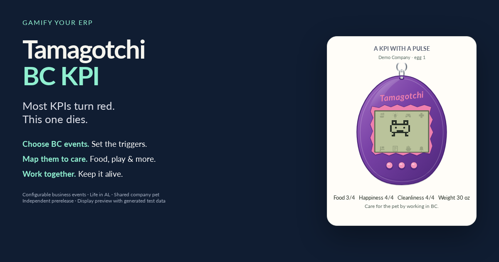

# Tamagotchi BC KPI

**Gamify your ERP. This KPI has a pulse.**

Most KPIs turn red when you neglect them. This one dies.

A company-shared, P1-inspired virtual pet lives on your Microsoft Dynamics 365
Business Central Role Center. You care for it through configurable BC event mappings:
choose which supported business events provide food, cleaning, play, medicine
and bedtime care. The company decides which activities keep its pet alive.

The life engine is written in **AL**. BC's standard Job Queue advances it even
when everyone has logged off. It sleeps, gets sick, develops into different
characters and can die. Logging in or posting another invoice does not revive it.

**If you fail to grow the business, your Tamagotchi will die of starvation.
Just like your users might.**

The joke is dark. The implementation counts selected business events, not growth,
profitability, invoice value or employee performance. Every qualifying invoice is
one meal attempt; the pet can refuse care while asleep, sick or already full.

## What you get

- One persistent pet per BC company, shared by all users.
- Hunger, happiness, cleanliness, weight, discipline, illness, sleep and evolution.
- Care advice follows the configured events and becomes more urgent as needs worsen.
- A dedicated Accountant with Tamagotchi Role Center and visible care receipts.
- Eight classic-style cabinets; their three buttons are decorative.
- Configurable care mappings with defaults and an event history.
- Danish, English UK and English US, following each BC user's language.
- Native AL life, saved death timestamps and an explicit administrator reset.
- Source code, a compiled `.app`, a separate BC test app and build instructions.

## Current release

**0.3.0.0 is a prerelease for sandbox testing.** Both AL apps compile against BC
27.0, Cloud / runtime 16.0. The local suite has 29 checks. Twenty-five BC AL tests
are compiled; they have not yet run in a BC tenant. Installation, the actual
background scheduler and real posting scenarios remain to be verified there.

Download `ERP Heritage_Tamagotchi BC KPI_0.3.0.0.app` from this repository's
**Releases** and follow the [installation guide](docs/INSTALLATION.md). After
installation, open Setup and choose **Create / restart background job**. Tasks
are created explicitly rather than during installation or New egg.
The separate Tests app is for a dedicated test company.

## Default care mappings

| Pet care | Business Central event |
|---|---|
| Food | Sales invoice posted |
| Cleaning | Customer entries applied through Apply Entries |
| Play | Customer payment posted |
| Medicine | Purchase invoice posted |
| Discipline | Sales order manually released |
| Lights on | Purchase order manually released |
| Lights off | Bank reconciliation posted |
| Snack | Sales credit memo posted |

Choose from these eight supported event types or **None** for each care action
in **Tamagotchi Setup**. See [configuration](docs/CONFIGURATION.md) for the
complete behavior and [the user guide](docs/USER-GUIDE.md) for keeping it alive.

## Documentation and code

- [Install and assign permissions](docs/INSTALLATION.md)
- [Configure the pet and event mappings](docs/CONFIGURATION.md)
- [Care, lifetime and troubleshooting](docs/USER-GUIDE.md)
- [Architecture and event publishers](docs/ARCHITECTURE.md)
- [Build from source](docs/BUILDING.md)
- [Testing and release acceptance](docs/TESTING.md)
- [Known limits and P1 reconstruction choices](docs/KNOWN-LIMITATIONS.md)
- [Contributing](CONTRIBUTING.md) · [Changelog](CHANGELOG.md)

Main AL source: [`extensions/bc-tamagotchi/src`](extensions/bc-tamagotchi/src).
BC test source: [`extensions/bc-tamagotchi-tests/src`](extensions/bc-tamagotchi-tests/src).

## Inspiration and credits

Inspired by **Erik Hougaard** and his
[BusinessCentralDoom](https://github.com/hougaard/BusinessCentralDoom) project.
DOOM in Business Central prompted a different question: what if the ERP itself
was how you played? Credit is for inspiration; this project contains no DOOM code.

Thanks also to **rhubarbtart** for the first-hand
[vintage P1 research](https://rhubarbtart.neocities.org/p1hackinglog) used as
parameter and growth-chart references. See [CREDITS](CREDITS.md) and [NOTICE](NOTICE.md).

## License

Distributed under **GPL version 2**; the full text is in [LICENSE](LICENSE).
Some project-owned files also offer GPL-2.0-or-later; this distribution uses v2.
The corresponding source accompanies the compiled release.

This is an independent P1-inspired recreation, not Bandai's original source code
or a verified identical implementation. The package includes no original firmware,
original sprites, reference photographs or external game runtime. Tamagotchi is a
Bandai brand; this project is not affiliated with or endorsed by Bandai or Microsoft.
