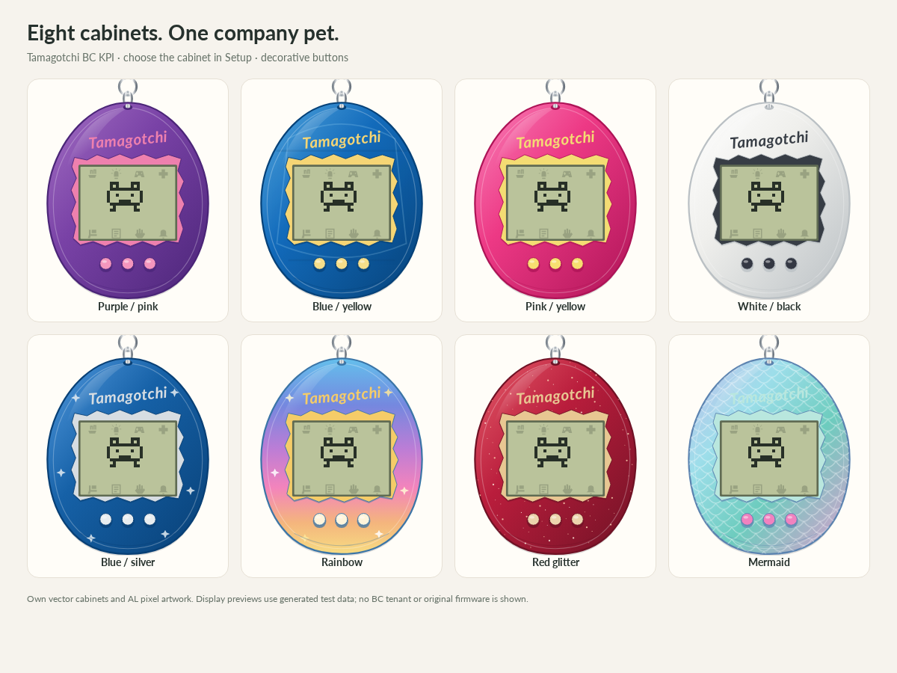

# Configuration

Open **Tamagotchi Setup**. Settings belong to the BC company; user language belongs
to each user's BC preferences. Everyone in a company sees and cares for the same pet.

## Care mappings

| Care | Default event | Effect when accepted |
|---|---|---|
| Food | Sales invoice posted | Adds one hunger heart and one weight unit |
| Cleaning | Customer entries applied | Clears accumulated droppings; does not cure illness |
| Play | Customer payment posted | Plays five simulated rounds; a win can add happiness |
| Medicine | Purchase invoice posted | Gives one dose; required doses depend on the character |
| Discipline | Sales order manually released | Responds to a pending discipline call |
| Lights on | Purchase order manually released | Turns on the pet's light |
| Lights off | Bank reconciliation posted | Turns off the pet's light |
| Snack | Sales credit memo posted | Adds one happiness heart and two weight units |

Each dropdown selects one of these **eight supported BC events** or **None**.
This is an implemented event catalog, not a live browser of all AL publishers.
Adding another event type requires an enum value, subscriber and tests in AL.

Several care actions can share one event. All configured actions are queued in
care order: food, cleaning, play, medicine, discipline, lights on, lights off, snack.
Ordering matters: food attempted before medicine can be refused while the pet is sick.
For example, mapping both light actions to one event leaves the light off because
the off action is processed later.

Only new events use changed mappings. Previously queued events retain the care
action selected when they were captured. Document amounts do not affect rewards.
Care can be refused because of an egg, death, sleep, illness or a full relevant meter.

**Enabled** defaults to **No** for new setups. Turn it on to opt the company into
care collection. Existing enabled values survive upgrade. **Enabled** controls collection of care events. Disabling it does **not** pause
the pet, discard already queued care or stop the background job.

## Pet clock and sound

The clock uses BC's current time and an automatically recorded BC time zone,
shared by viewers and the background worker. Setup captures its administrator's
BC zone on first opening/activation. The read-only **BC time zone** field identifies
it. There are no manual hour/minute fields or Set clock action. DST is resolved
for each simulated timestamp. Before a zone is captured, UTC is the fallback.

**Play attention sound** allows the display to beep. The browser may still need
the user to click **Enable sound**. A closed browser does not produce sound;
it also does not stop the pet's life.

## Cabinet

Choose Purple/pink, Blue/yellow, Pink/yellow, White/black, Blue/silver, Rainbow,
Red glitter or Mermaid. Purple/pink is the default. This is visual only:
same pet, same rules, no reset. The three device buttons are decorative.
It does not select Gen 2 or force a specific character.

## Background life and reset

Setup shows **Job status** and **Last background update**. A fresh installation
shows **Not created** until you choose **Create / restart background job**. That
action creates and saves the job, or restarts the existing one after errors are
resolved. It does not hatch another pet. Installation, upgrades and New egg do
not create or restart tasks. An administrator-held job is not resumed by viewing.

**New egg / reset** archives the previous life, increases the generation and
explicitly starts a new egg. The previous life and event history are retained.
Old-generation events cannot feed the new pet.

Changing a cabinet or mapping does not revive a dead pet. There is no
weekend exemption or setting to make time stop when users log off.
